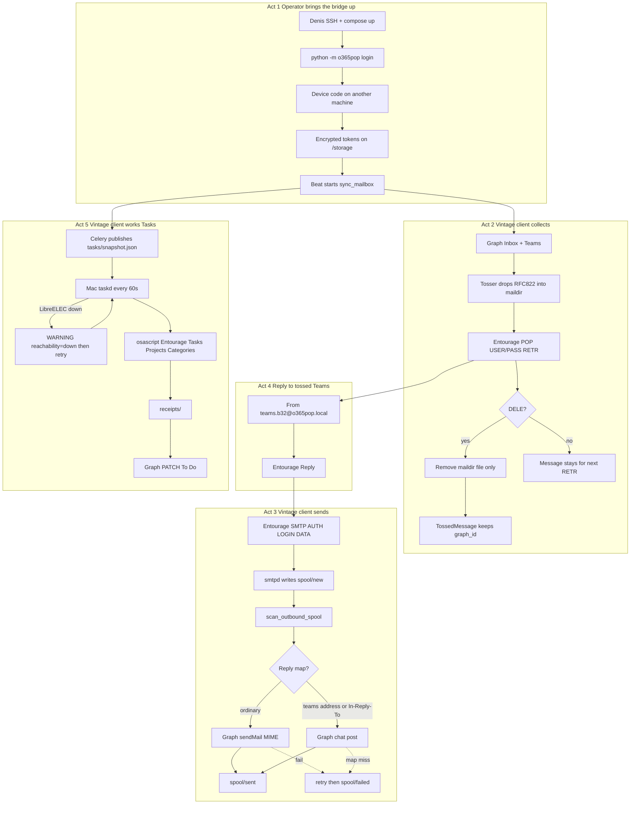

# Dialogue map — Collect and send through the bridge

**ESM-04 (stack-adjusted).** Not a GUI screen flow. Actors: Denis (operator), Entourage (vintage client), Celery (worker/beat), Graph, Mac `taskd`.

Feature files: `docs/features/act-1-bridge/*.feature`. Phrase map: `docs/features/CATALOG.md`.
